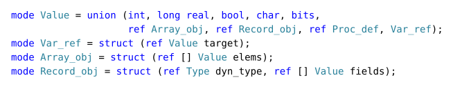

# Titania

Titania is an AST-walking interpreter for
[Oberon-07](https://people.inf.ethz.ch/wirth/Oberon/Oberon07.Report.pdf),
written in Algol 68 and compiled with
[a68j](https://github.com/stefan-zobel/a68j). It loads one source file, together
with the modules that file imports, and runs it. There is no REPL, and speed is
secondary.

The program is a showcase for Algol 68: the syntax tree is a `union` handled
with conformity clauses, `VAR` parameters are references, and storage management
is left to the garbage collector. It uses only the standard prelude and the
POSIX module, so it needs neither `-fnest-java` nor any Java code.

The design is described in detail in [docs/design.md](docs/design.md).

## Build and run

Titania needs JDK 25 or later and a68j. By default, `build.sh` expects a built
a68j next to this directory, in `../a68j`.

```sh
JAVA=/path/to/jdk-25/bin/java A68J_HOME=/path/to/a68j/backend sh build.sh
```

This writes `titania.jar`, which runs together with `a68j-runtime.jar` of the
same a68j version:

```sh
java -cp titania.jar:/path/to/a68j/backend/a68j-runtime.jar Titania Hello.Mod
```

On Windows the class path separator is `;`. A program to try:

```
MODULE Hello;
  IMPORT Out;
BEGIN
  Out.String("Hello, world!"); Out.Ln
END Hello.
```

The command line is `titania [-I DIRECTORY]... [-oberonc] FILE`. A module `M` is
read from the file `M.Mod`, in the directory of the importing file or else in a
directory given with `-I`. With `-oberonc`, Titania also predeclares the names
that the test programs of the compiler `oberonc` use.

## Language

Titania implements the Oberon-07 report of 3 May 2016, without the module
`SYSTEM`.

| Oberon | Algol 68 | Notes |
|---|---|---|
| `INTEGER` | `int` | 32 bits |
| `BYTE` | `int` | reduced to 0..255 on store |
| `REAL` | `long real` | 64 bits, the report leaves the size open |
| `BOOLEAN` | `bool` | |
| `CHAR` | `char` | `CHR` reduces its operand to 0..65535 |
| `SET` | `bits` | elements 0..31 |

## Library

The report defines no input or output, so these modules are built in. A source
file with the same name takes precedence.

| Module | Contents |
|---|---|
| `Out` | `Open`, `Char`, `String`, `Int`, `LongInt`, `Real`, `LongReal`, `Fixed`, `Ln`, `Hex`, `Flush` |
| `In` | `Open`, `Int`, `LongInt`, `Real`, `LongReal`, `Char`, `String`, `Done` |
| `Math`, `MathL` | `pi`, `e`, roots, powers, logarithms, trigonometric and hyperbolic functions |
| `Strings` | `Length`, `Append`, `Insert`, `Delete`, `Replace`, `Extract`, `Pos`, `Cap`, `Copy`, `Write`, `WriteChar`, `AppendChar`, `WriteInt`, `AppendInt` |

## Structure

The source is split into files with one-way dependencies, in this order:

| File | Contents |
|---|---|
| `src/scanner.a68` | symbols, positions, diagnostics |
| `src/syntax.a68` | modes of types, objects, tree nodes and runtime values; operations on values |
| `src/library.a68` | native `Out`, `In`, `Math` and `Strings` |
| `src/parser.a68` | single-pass parser with type checking; builds the tree and resolves names |
| `src/interp.a68` | `eval`, `exec`, `locate`, module initialization |
| `src/titania.a68` | command line; includes the other files |

As in Wirth's compilers, one pass over the source parses, checks types and
builds the tree. The parser resolves every name to a frame slot, a global slot,
a field index or a procedure definition, so the interpreter never looks up an
identifier.

## Runtime values

[](src/syntax.a68)

Arrays and records are objects owned by their slot, and assignment copies them
deeply. Pointers share the object. A `VAR` parameter of scalar, pointer or
procedure type holds a `Var_ref` to the actual variable; one of aggregate type
shares the object, which also carries the length and the dynamic type.

## Execution

Three mutually recursive procedures walk the tree: `eval` computes an expression,
`exec` executes a statement and `locate` yields the variable of a designator.

Oberon-07 allows `RETURN` only at the end of a function, so a call runs the body
and then evaluates the result expression, and no jumps are needed. Local
variables live in one shared stack of 1 million slots, and `base` is the position
of the current frame. Calls are limited to a depth of 50000.

## Diagnostics

| Situation | Output | Exit status |
|---|---|---|
| Error in the source | `FILE:LINE:COLUMN: error: MESSAGE` | 1 |
| Runtime error | `FILE:LINE: runtime error: MESSAGE` | 2 |
| `HALT(n)` | none | `n` |

## Testing

`python3 tools/run_tests.py` runs everything in `tests/`.
[`oberonc`](https://github.com/lboasso/oberonc) is the reference compiler. Its
test suite is copied to `tests/oberonc`, with its MIT license and a
[list of what was left out or changed](tests/oberonc/README.md). The expected
output in `tests/core` is recorded from `oberonc`; `tests/spec`, `tests/import`,
`tests/errors` and `tests/runtime` are written by hand.

`oberonc` has a 32-bit `REAL`, so the last digits of printed reals can differ.
Where `oberonc` deviates from the report, Titania follows the report.

## License

Titania is licensed under the [Apache License, Version 2.0](LICENSE).
Copyright The Titania authors.

The programs in `tests/oberonc` are from the test suite of `oberonc`, copyright
Luca Boasso, and remain under the MIT license in `tests/oberonc/LICENSE.txt`.
